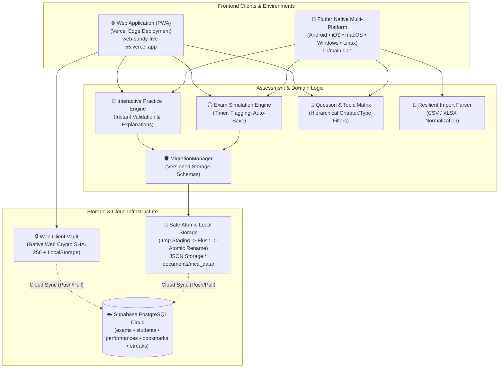
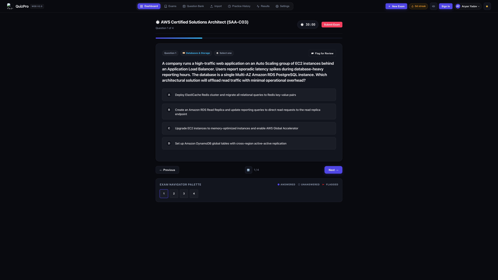

<div align="center">

# 🎓 QuizPro
### *Modern Cross-Platform MCQ Examination Simulator & Certification Practice Engine*

[](https://flutter.dev)
[](https://dart.dev)
[](https://supabase.com)
[](https://web-sandy-five-55.vercel.app)
[](https://github.com/Coderaryanyadav/QuizPro)
[](https://github.com/Coderaryanyadav/QuizPro/actions/workflows/flutter.yml)
[](https://github.com/Coderaryanyadav/QuizPro)
[](https://github.com/Coderaryanyadav/QuizPro)
[](LICENSE)

<br/>

**[🚀 Live Web Simulator](https://web-sandy-five-55.vercel.app)** &nbsp;•&nbsp;
**[📊 Executive Project Overview](./docs/QuizPro_Executive_Project_Overview.pdf)** &nbsp;•&nbsp;
**[🗺️ Capabilities Roadmap](./docs/Flutter_NextGen_Capabilities_Roadmap.pdf)** &nbsp;•&nbsp;
**[📐 Data Architecture](./docs/DATA_ARCHITECTURE.md)** &nbsp;•&nbsp;
**[🤝 Contributing](./CONTRIBUTING.md)**

</div>

---

## 📖 Overview

**QuizPro** is an enterprise-grade, cross-platform MCQ examination simulator and adaptive learning platform engineered for standardized certification preparation (e.g., AWS, CIA, CISA, PMP, SQL, and medical licensure). Available as both a high-fidelity **Flutter Native Application** (Android, iOS, macOS, Windows, Linux) and a low-latency **Progressive Web App on Vercel**, QuizPro empowers students and organizations to author, import, simulate, and dissect complex multiple-choice evaluations with uncompromising reliability.

The platform pairs a zero-data-loss atomic local persistence engine with optional **Supabase Cloud PostgreSQL** synchronization, resilient CSV/Excel spreadsheet ingestion, timed exam environments, interactive drill practice modes with per-option explanations, multi-student profile isolation, and chronological performance analytics.

### ✨ Key Capabilities

- 🛡️ **Update-Safe Data Migration Pipeline**: Built-in `MigrationManager` guarantees that application updates preserve 100% of user profiles, learning progress, past exam snapshots, bookmarks, and configurations without data loss.
- 🎯 **Hierarchical Question-Type & Chapter Matrix**: Granular filtering by question type (_Single Choice_, _Multiple Select_, _True/False_) and chapters/topics with dynamic availability counters.
- 👥 **Multi-Student Profiles & Complete Isolation**: Create distinct student identities with custom avatar emojis and colors; attempt histories, bookmarks, and metrics remain strictly separated.
- 📂 **Resilient CSV & Excel Ingestion**: Advanced alias normalization (`question_text`, `choice_1`–`4`, `correct_answer`, `explanation_a`–`d`) with automatic delimiter discovery, duplicate prevention, and real-time syntax previews.
- ⏱️ **Exam Simulator & Assessment Engine**: Timed and untimed simulation, review flags, rapid grid jumping, auto-submission on expiration, and lifecycle state persistence (`WidgetsBindingObserver`).
- 📘 **Interactive Practice Mode**: Instant option validation, comprehensive per-option explanations, elimination strikethroughs, and dedicated "Drill Mistakes" revision sessions.
- ⭐ **Bookmarking & Starred Revision**: Star challenging questions across any test; filter question banks to rehearse flagged questions.
- 📈 **Chronological Analytics & Deep Snapshots**: Learning curves computed from earliest to latest attempts with immutable question-state snapshots preserving history integrity even after editing source banks.
- 💾 **Atomic Local File Persistence**: Safe staged writes (`.tmp_${timestamp}` -> flush -> rename/replace) guarding against power loss, process termination, or mobile background kills.
- ☁️ **Supabase Cloud PostgreSQL Sync**: 1-click push and pull to synchronize question banks, profiles, and attempt histories across all desktop and mobile devices.
- 🌓 **Semantic Design System & Dark Mode**: Seamless `System`, `Light`, and modern slate `Dark` modes with instant reactive theme propagation.
- ⌨️ **Desktop Keyboard Shortcuts**: Native desktop bindings (`1`-`4` or `A`-`D` for options, `Arrow keys` for navigation, `Space`/`M` for flag, `Enter` to confirm).

---

## 📑 Table of Contents

- [📐 System Architecture Diagram](#-system-architecture-diagram)
- [📸 Screenshots & Visual Tour](#-screenshots--visual-tour)
- [🌐 Live Web Application (Vercel)](#-live-web-application-vercel)
- [☁️ Supabase Cloud Database Integration](#️-supabase-cloud-database-integration)
- [🌐 Supported Platforms](#-supported-platforms)
- [📥 Importing Questions (CSV & Excel)](#-importing-questions-csv--excel)
- [💾 Atomic Storage & Security](#-atomic-storage--security)
- [🏛️ Repository Layout & Architecture](#️-repository-layout--architecture)
- [🚀 Installation & Setup](#-installation--setup)
- [🧪 Testing & Quality Assurance Summary](#-testing--quality-assurance-summary)
- [🛠️ Build & Release Pipeline](#️-build--release-pipeline)
- [🤝 Contributing & Security](#-contributing--security)
- [📄 License](#-license)

---

## 📐 System Architecture Diagram



---

## 📸 Screenshots & Visual Tour

### 🖥️ Desktop Experience (UltraHD)

| Executive Dashboard | Question Import Preview | Timed Exam Simulation |
| :---: | :---: | :---: |
| [](Screenshots/UltraHD_Desktop/01_Executive_Dashboard.png) | [](Screenshots/UltraHD_Desktop/12_Import_Questions_Modal.png) | [](Screenshots/UltraHD_Desktop/08_Timed_Exam_Simulation.png) |

| Exam Catalog & Launcher | Question Bank Matrix | Performance Analytics |
| :---: | :---: | :---: |
| [](Screenshots/UltraHD_Desktop/02_Exam_Catalog.png) | [](Screenshots/UltraHD_Desktop/03_Question_Bank_Matrix.png) | [](Screenshots/UltraHD_Desktop/04_Performance_Analytics.png) |

| Exam History Log | Settings & Cloud Configuration | Question Editor Modal |
| :---: | :---: | :---: |
| [](Screenshots/UltraHD_Desktop/05_Exam_History.png) | [](Screenshots/UltraHD_Desktop/06_Settings_Preferences.png) | [](Screenshots/UltraHD_Desktop/14_Question_Editor_Modal.png) |

### 📱 Mobile Experience (UltraHD)

| Mobile Dashboard | Interactive Practice | Timed Simulation | Score & Results |
| :---: | :---: | :---: | :---: |
| [](Screenshots/UltraHD_Mobile/01_Executive_Dashboard.png) | [](Screenshots/UltraHD_Mobile/07_Interactive_Practice_Mode.png) | [](Screenshots/UltraHD_Mobile/08_Timed_Exam_Simulation.png) | [](Screenshots/UltraHD_Mobile/09_Score_Results_Screen.png) |

---

## 🌐 Live Web Application (Vercel)

The complete QuizPro evaluation platform is deployed live on Vercel:

🚀 **Production Web App**: [https://web-sandy-five-55.vercel.app](https://web-sandy-five-55.vercel.app)

### Web App Architecture Highlights

- **Pure Clean Slate Initialization**: Launches immediately with zero unwanted dummy data; optional `✨ Load Sample Test` provides 1-click feature exploration.
- **Client-Side SHA-256 Authentication**: Secure registration and login powered by the browser's native **Web Crypto API** with encrypted vault persistence, guest mode (`⚡ Continue as Guest`), and instant `🎯 Try Demo Account`.
- **☁️ Supabase Cloud Integration**: Connect your Supabase PostgreSQL database to seamlessly sync tests, questions, and attempt records across web and mobile.
- **🎉 Particle Celebrations**: High-velocity canvas confetti physics trigger when achieving passing scores and study streak milestones.
- **🔊 Web Audio API Synthesizer**: Pure programmatic sound chimes for correct responses, gentle buzzers for mistakes, and audio fanfare on completion (toggleable anytime via `🔊`).
- **Full Data Portability**: Single-click JSON backup export and restore fully interoperable between web and Flutter desktop/mobile builds.

---

## ☁️ Supabase Cloud Database Integration

QuizPro features optional PostgreSQL cloud sync using **Supabase**:

### 1. Database Schema Initialization

Execute the production SQL schema located in [`supabase/schema.sql`](supabase/schema.sql) in your Supabase project:

1. Open your [Supabase Dashboard](https://supabase.com/dashboard) and select your project.
2. Navigate to **SQL Editor** -> **New Query**.
3. Paste the contents of [`supabase/schema.sql`](supabase/schema.sql) and click **Run**.

### 2. Supported PostgreSQL Tables

| Table | Description | Primary Key | Key Columns |
| :--- | :--- | :--- | :--- |
| `exams` | Exam metadata, time limits, passing thresholds | `id` (text) | `name`, `category`, `passing_percentage`, `questions` (JSONB) |
| `students` | Student profiles and goals | `id` (text) | `name`, `avatar`, `color`, `target_score` |
| `performances` | Test attempt records and audit histories | `id` (text) | `exam_id`, `student_id`, `score`, `passed`, `time_spent`, `answers` (JSONB) |
| `bookmarks` | Starred questions per student | `student_id, question_id` | `exam_id`, `created_at` |
| `streaks` | Daily study streak and goal records | `student_id` | `current_streak`, `last_study_date`, `daily_goal` |

### 3. Connecting to Supabase in the Application

1. Open QuizPro -> Navigate to **⚙️ Settings**.
2. Under **☁️ Supabase Cloud Database**, supply:
   - **Project URL** (e.g. `https://your-project.supabase.co`)
   - **Anon Public API Key** (`eyJhbGci...`)
3. Click **💾 Save Config** -> **⚡ Test Connection**.
4. Use **⬆️ Push to Cloud** to backup local exams, or **⬇️ Pull from Cloud** to sync banks to any new workstation.

---

## 🌐 Supported Platforms

| Platform | Support Tier | Architecture / Distribution | Minimum OS Version |
| :--- | :---: | :--- | :--- |
| 🤖 **Android** | Production | ARM64, ARMv7, x86_64 (Release APK & AAB) | Android 5.0+ (API 21+) |
| 🍏 **macOS** | Production | Apple Silicon & Intel Universal App Bundle | macOS 10.14+ (Mojave+) |
| 📱 **iOS** | Production | Release IPA & Simulator builds | iOS 12.0+ |
| 🪟 **Windows** | Supported | x64 Standalone Executable & Bundle | Windows 10+ (64-bit) |
| 🌐 **Web** | Production | Responsive Progressive Web App (Edge CDN) | Chrome, Safari, Firefox, Edge |
| 🐧 **Linux** | Supported | GTK+ 3.0 Desktop binary | Ubuntu 20.04+, Debian 10+ |

---

## 📥 Importing Questions (CSV & Excel)

QuizPro supports flexible batch ingestion via **CSV** and **Excel (.xlsx)** spreadsheet formats.

### Standard CSV Specification

```csv
Question,Option A,Option B,Option C,Option D,Correct Answer,Explanation A,Explanation B,Explanation C,Explanation D,Chapter,Topic,Difficulty,Tags
"What is Docker?",Container runtime,Operating system,Web browser,Database,A,"Docker manages containers","Not an OS","Not a browser","Not a database","Virtualization","Containers",2,"devops,containers"
"Which are relational databases?",PostgreSQL,MongoDB,MySQL,Redis,A|C,"PostgreSQL is SQL","MongoDB is NoSQL","MySQL is SQL","Redis is Key-Value","Databases","RDBMS",3,"sql,rdbms"
"DNS translates domain names to IP addresses.",True,False,,,A,"DNS resolves names to IPs","False is incorrect","","","Networking","Protocols",1,"dns,networking"
```

### Supported Header Aliases

- **Question Prompt**: `question`, `question_text`, `prompt`, `q`, `title`
- **Option Choices**: `option_a`–`option_d`, `choice_1`–`choice_4`, `answer_1`–`answer_4`
- **Correct Answer**: `correct_answer`, `correct`, `answer`, `key` (Supports letters `A`-`D`, indices `1`-`4`, multi-select pipe syntax `A|C`, or exact option text)
- **Explanations**: `explanation`, `explanation_a`–`explanation_d`, `rationale`
- **Taxonomy & Metadata**: `chapter`, `topic`, `difficulty` (`1`–`5`), `tags`

---

## 💾 Atomic Storage & Security

- **100% Offline-First Architecture**: All student profiles, examinations, question items, and progress logs are saved locally in the device's application documents sandbox (`mcq_data/`).
- **Atomic File Operations**: Disk persistence employs staged writes (`.tmp_${timestamp}` -> flush -> rename/replace). Abrupt termination or device shutdowns cannot corrupt database files.
- **Historical Snapshots**: Performance records store immutable question snapshots at the moment of completion, guaranteeing reports stay valid even if exams are later modified or deleted.
- **Compliant Ad Integration**: Google Mobile Ads (AdMob) is integrated following strict Google Play Developer policies with configurable banner widgets and user consent handling.

---

## 🏛️ Repository Layout & Architecture

```text
QuizPro/
├── .github/workflows/          # GitHub Actions CI/CD workflows (Flutter CI)
├── assets/                     # Application icons and bundled sample datasets
├── docs/                       # Engineering specifications and generated documentation
│   ├── audits/                 # Security, performance, and documentation audits
│   ├── screenshots/            # Standard UltraHD documentation screenshot assets
│   ├── DATA_ARCHITECTURE.md    # Persistence contracts & atomic I/O blueprints
│   ├── DATA_MODEL.md           # Schema definitions and entity relationship specs
│   ├── MIGRATIONS.md           # Safe migration engine guide & version registry
│   ├── RELEASE.md              # Production deployment checklist
│   ├── Flutter_NextGen_Capabilities_Roadmap.pdf  # Executive capabilities roadmap
│   └── QuizPro_Executive_Project_Overview.pdf    # Executive project overview document
├── lib/                        # Flutter Native Application Source Code
│   ├── main.dart               # App entrypoint, theme listener, and route initialization
│   ├── models/                 # Domain entities (Exam, Question, Performance, StudentProfile)
│   ├── repositories/           # Storage repository abstractions and atomic I/O engine
│   ├── screens/                # UI screens (Home, Exam, Practice, QuestionBank, Stats, Settings)
│   ├── services/               # Business logic (MigrationManager, Analytics, ImportService, Streak)
│   ├── theme/                  # Theme tokens (AppTheme, Slate Dark Mode, Typography)
│   ├── utils/                  # Validators, formatters, and helper utilities
│   └── widgets/                # Reusable UI widgets (OptionShape, Logo, Matrix, BannerAd)
├── scripts/                    # Automation, screenshot capture & multi-platform build scripts
├── supabase/                   # Supabase PostgreSQL schema and cloud migration scripts
├── test/                       # 83 Flutter automated unit, widget, and integration tests
├── tests/                      # 71 Node.js headless web audit & storage assertions
└── web/                        # Responsive PWA Web Application (HTML5, CSS3, JS, Web Audio)
```

---

## 🚀 Installation & Setup

### Prerequisites

- **Flutter SDK**: `>=3.10.0` (Dart SDK `>=3.0.0 <4.0.0`)
- **Node.js**: `>=18.x` (for running web test audits and automation scripts)
- **Platform Toolchains**:
  - Android Studio / Android SDK (for Android builds)
  - Xcode & CocoaPods (for iOS & macOS builds)

### 1. Clone the Repository

```bash
git clone https://github.com/Coderaryanyadav/QuizPro.git
cd QuizPro
```

### 2. Install Flutter Dependencies

```bash
flutter pub get
```

### 3. Run Locally

```bash
# Web Application
flutter run -d chrome

# macOS Desktop
flutter run -d macos

# Android Device / Emulator
flutter run -d android

# iOS Simulator
flutter run -d ios
```

---

## 🧪 Testing & Quality Assurance Summary

QuizPro maintains a comprehensive multi-layered automated test suite covering serialization, atomic persistence, student profile isolation, and web storage mechanics:

```bash
# 1. Verify Dart formatting across lib and test
dart format --output=none --set-exit-if-changed lib test

# 2. Run Flutter static analyzer
flutter analyze

# 3. Execute all 83 Flutter unit & widget tests
flutter test

# 4. Execute all 71 Web storage & assessment audit assertions
npm test
```

### 📊 Test Suite Coverage Breakdown

| Test Suite | File | Tests / Assertions | Key Tested Scenarios |
| :--- | :--- | :---: | :--- |
| **Database Persistence** | `test/database_persistence_test.dart` | 12 | Cold-restart simulation, atomic replace, safe purge |
| **Production Audit** | `test/production_audit_test.dart` | 15 | Multi-student data isolation, leak prevention, concurrent attempts |
| **Migration Upgrade** | `test/migration_upgrade_simulation_test.dart` | 8 | V1 to V2 migration schema integrity without data wipe |
| **Chapter & Topic Matrix** | `test/chapter_topic_test.dart` | 10 | Hierarchical taxonomy discovery, sorting, and filter matching |
| **CSV & Excel Import** | `test/import_test.dart` | 14 | Malformed rows, alias mapping, multi-select parsing |
| **Exam & Performance** | `test/exam_session_test.dart` | 8 | Snapshot serialization, time logging, pass evaluation |
| **Input Validation** | `test/validators_test.dart` | 9 | Option count, difficulty range, answer boundary validation |
| **Widget & UI** | `test/widget_test.dart` | 7 | Screen rendering, keyboard events, modal confirmations |
| **Web Hardcore Audit** | `tests/hardcore_full_audit.mjs` | 71 | Web LocalStorage CRUD, SHA-256 vault, assessment DOM |

---

## 🛠️ Build & Release Pipeline

### 🚀 One-Command Master Build

Compile all supported platform binaries and package them into `release_bundles/`:

```bash
./build_all.sh
```

### 🎯 Dedicated Platform Build Scripts

Individual platform scripts are available in `scripts/`:

- **Android (APK & AAB)**: `./scripts/build_android.sh` (`--aab` for Google Play bundle)
- **macOS Desktop**: `./scripts/build_macos.sh`
- **iOS (IPA)**: `./scripts/build_ios.sh` (`--signed` for App Store certificate signing)
- **Windows Desktop**: `./scripts/build_windows.sh` (or `.\scripts\build_windows.ps1` on Windows)

---

## 🤝 Contributing & Security

We welcome community pull requests, issue reports, and suggestions!

- **Contributing**: Please review [CONTRIBUTING.md](CONTRIBUTING.md) and [CODE_OF_CONDUCT.md](CODE_OF_CONDUCT.md) for branch naming (`feat/`, `fix/`) and coding conventions.
- **Security Inquiries**: For responsible vulnerability disclosure, refer to our [Security Policy](SECURITY.md).

---

## 📄 License

This project is licensed under the MIT License - see the [LICENSE](LICENSE) file for details.
